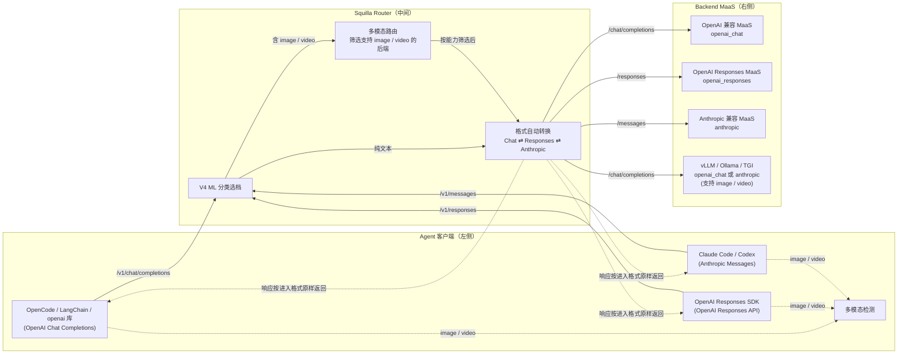

# Squilla API Router

一个 HTTP 服务：精准 SquillaRouter ML 分类 + 模型分级路由 + 后端 LLM 调用。

## 架构

```text
你的智能体（OpenAI Chat / Anthropic Messages 格式）
        ↓ http://127.0.0.1:8021
Squilla API Router（一个进程：ML 分类 → 策略门控 → 选模型 → 调用）
        ↓
模型池
  c0 → Qwen3.8-27B（便宜快速）
  c1 → Qwen3.5-397B-A17B（均衡）
  c2 → GLM-5.3-Flash（中等偏强）
  c3 → DeepSeek-V4.1-Flash（最强）
```

使用和 OpenSquilla 相同的 V4 Phase 3 ML 分类器（BGE + LightGBM + MLP），
相同 4 阶段策略管道。中文友好。

## 支持的 API 格式

| 端点 | 格式 | 适用框架 |
|------|------|---------|
| `POST /v1/chat/completions` | OpenAI Chat Completions | LangChain、OpenCode、openai 库 |
| `POST /v1/responses` | OpenAI Responses API | OpenAI Responses SDK |
| `POST /v1/messages` | Anthropic Messages | Codex、Claude Code、Anthropic SDK |

三种格式均支持流式（SSE）。**客户端（Agent）用什么格式进来，收到的就是什么格式返回**；后端按它声明的原生 API 格式自动转换，用户无需关心 Agent 能否直接接入后端服务。

Router 的完整链路：鉴权 → 图片/视频检测 → V4 分类选模型 → 替换 `model` 字段 → 按后端原生格式自动转换并转发 → 按进入格式原样转回。

### 请求流示意图



### 自动转换示例

例如 Agent 以 **OpenAI Chat Completions** 接入（`/v1/chat/completions`），而本次路由到的后端只支持 **Anthropic Messages**（Anthropic 兼容 MaaS 的 `/messages`）：

```text
 Agent                        Squilla Router                后端（Anthropic 兼容 MaaS）
  │   OpenAI Chat 请求          │                                    │
  ├────────────────────────────►│  ML 分类选 R3                       │
  │                             │  请求转成 Anthropic Messages ─────►│  /messages
  │                             │                                    │
  │                             │  ◄─────────────────────────────────┤  Anthropic 响应
  │   OpenAI Chat 响应           │  响应转回 OpenAI Chat               │
  ◄────────────────────────────┤                                    │
```

流式同样自动转换（SSE 进、SSE 出）：例如 Agent 用 Chat 流接入、后端返回 Anthropic 流，Router 会把 Anthropic 的 `message_start / content_block_delta / message_stop` 实时转成 Chat 的 `chat.completion.chunk` 流。

转换由内置的 llm-rosetta 双向桥接完成：OpenAI Chat ⇄ Responses ⇄ Anthropic 全 6 方向自动转换（请求、响应、流式），无需额外网关或 SDK 适配。每个 Provider 在 `.env` 里用 `XXX_FORMAT` 声明其原生格式（`openai_chat` / `openai_responses` / `anthropic`），未声明默认 `openai_chat`。

## 快速启动

```powershell
# 1. 复制环境变量模板，填入后端地址和 key
Copy-Item .env.example .env
# 编辑 .env

# 2. 安装依赖
pip install -r requirements.txt

# 3. 启动
uvicorn app:app --host 127.0.0.1 --port 8021
```

## 智能体接入

### Session/Task 粘性路由

Router 默认在同一个任务内保持 provider、model、API 格式和 endpoint 不变，
以降低模型切换并提高 KV cache 连续性。此功能不修改任何用户消息或工具定义。

```text
X-Squilla-Session-Id: my-agent-session
X-Squilla-Task-Id: optional-task-id
X-Squilla-Intent: new_task | continue | redo | task_changed
X-Squilla-Quality-Feedback: validation_failed | tool_failed | no_progress
```

未提供 session header 时，Router 会用首个用户目标、system/tools schema 和
客户端指纹生成隐式 session。Continue 默认粘住当前模型；Redo 只升一级且不会
静默降级；Task Changed 会创建新 task 并重新选择模型。
Harness 检测到输出校验失败、tool call 失败或无进展时，可通过
`X-Squilla-Quality-Feedback` 触发一次 Redo；该信号只影响路由，不修改请求。

```env
ROUTER_SESSION_STICKY=1
ROUTER_TASK_CHANGE_SIMILARITY=0.15
ROUTER_TASK_CHANGE_MODE=safe_hybrid
ROUTER_TASK_CHANGE_HARD_THRESHOLD=0.45
ROUTER_TASK_CHANGE_SOFT_THRESHOLD=0.20
```

响应会返回 `X-Squilla-*` 路由状态头。查看状态：

```text
GET /admin/routing-state?session_id=...
```

### 安全任务变化判断（#5）

`safe_hybrid` 用本地 BGE + 小型二分类模型处理规则无法确定的轮次。它不是
“分类器永不犯错”的承诺，而是保证误判不会导致新任务继续锁在低能力模型：

```text
p(change) >= 0.45   -> 确认 Task Changed，创建新 task 并正常选模型
0.20 <= p < 0.45    -> 保持 task_id，但 force reclassify 本轮强制重新选模型
p(change) < 0.20    -> 认为是同一任务，允许 session sticky
模型/文件不可用      -> 退回规则；模糊轮次强制重新分类
```

响应头：

```text
X-Squilla-Force-Reclassify: 0 | 1
X-Squilla-Task-Boundary: <reason>
X-Squilla-Task-Change-Probability: <0..1>
```

模型产物为 `model_bundle/task_change/v1.joblib`，旁边 `.sha256` 文件在加载前校验。
重新训练：

```powershell
python train_task_change_model.py
```

当前独立 holdout 的硬切换误拆率为 3.16%，真正且未触发重新分类的漏判率为 0。
`GET /router-status` 会显示模型是否成功加载及阈值。

### 成本感知路由（P1）

分类器给出的 tier 是最低质量约束。新任务允许在**不低于该 tier**的模型中
按预计总成本重新选择；Continue 仍保持当前模型以保护缓存连续性。

```env
ROUTER_COST_AWARE_ENABLED=1
ROUTER_MIN_PROFILE_OBSERVATIONS=3
ROUTER_PRICE_C0_CACHE_HIT=1
ROUTER_PRICE_C0_CACHE_MISS=10
ROUTER_PRICE_C0_OUTPUT=40
ROUTER_LARGE_CONTEXT_R2_TOKENS=25000
ROUTER_LARGE_CONTEXT_R3_TOKENS=80000
```

响应头会标记：

```text
X-Squilla-Classifier-Tier
X-Squilla-Cost-Aware
X-Squilla-Large-Context-Floor
```

单次请求可在不修改 body 的情况下切换策略：

```text
X-Squilla-Cost-Policy: cost_aware
X-Squilla-Cost-Policy: classifier
```

成本画像按任务类别分别记录：

```text
code / debug / design / explain / translate / math / tool / general
```

某个类别样本不足时，才回退到 tier 全局平均值。

### 后端熔断（P1）

失败或 429 后的模型会进入冷却，期间优先跳过该 provider/model。熔断状态写入
SQLite，同一数据库上的多个 worker/进程共享状态，服务重启后冷却仍有效：

```env
ROUTER_CIRCUIT_BREAKER_ENABLED=1
ROUTER_FAILURE_COOLDOWN_SECONDS=60
ROUTER_RATE_LIMIT_COOLDOWN_SECONDS=15
# 默认复用 ROUTER_STATE_DB；也可单独指定
# ROUTER_CIRCUIT_STATE_DB=.squilla_router_state.db
```

usage 账本同时记录成功调用和失败尝试：HTTP 状态、错误类型、尝试延迟和冷却时间。
如果后端或 SSE 没有返回 `usage`，Router 会根据请求和实际输出内容做保守估算，
并在 `usage_source` 中标记 `estimated`（部分来自供应商、部分估算则为 `mixed`）。
`/admin/routing-usage` 的 `estimated_usage_calls` 会汇总这类调用。

应用日志、uvicorn 错误日志和 access log 使用 `RotatingFileHandler`：

```env
ROUTER_LOG_ENABLED=1
ROUTER_LOG_FILE=squilla_router.log
ROUTER_ACCESS_LOG_FILE=squilla_router_access.log
ROUTER_LOG_MAX_BYTES=20971520
ROUTER_LOG_BACKUP_COUNT=5
```

达到大小后生成 `.1`、`.2` 等备份，默认单文件 20 MiB、保留 5 份。

Session 状态使用 revision 乐观并发控制，旧 revision 不能覆盖新状态。
默认 24 小时过期，可通过 `ROUTER_STATE_TTL_SECONDS` 修改；
`POST /admin/purge-state` 可手动清理过期状态。

Router 还会检查 provider 返回的 tool call 结构。若 tool name 缺失、arguments
不是合法 JSON object 或 Anthropic tool input 非法，会为当前 Session 标记一次
自动 Redo，在下一轮请求中提升质量层。该检查不修改当前响应。

连续相同 tool name + arguments 达到阈值时，也会判定为“重复 tool call 无进展”，
默认阈值为 3：

```env
ROUTER_REPEAT_TOOL_CALL_THRESHOLD=3
```

### OpenCode 多轮工具 A/B（P1）

同一任务分别使用 `router/router` 和固定
`starfire-jd/DeepSeek-V4.1-Flash` 运行，两个方案均通过 pytest：

| 指标 | Router/c0 | 固定 c3 |
|---|---:|---:|
| 模型轮次 | 3 | 4 |
| 工具调用 | 3 | 4 |
| 总 tokens | 28,584 | 37,364 |
| cache read | 0 | 29,568 |
| 成本单位 | 299,160 | 2,434,360 |
| 工具任务耗时 | 25.32s | 23.65s |

Router 成本低约 **87.7%**，但当时 tianhe c0 未返回 cache hit，
完整工具任务耗时慢约 **7.1%**。

### Codex / Claude Code（Anthropic Messages 格式）

在 `settings.json` 中配置：

```json
{
  "env": {
    "ANTHROPIC_BASE_URL": "http://127.0.0.1:8021",
    "ANTHROPIC_API_KEY": "anything"
  }
}
```

### LangChain / OpenCode / openai 库（OpenAI Chat 格式）

```python
from openai import OpenAI

client = OpenAI(
    base_url="http://127.0.0.1:8021/v1",
    api_key="anything",
)
response = client.chat.completions.create(
    model="router",
    messages=messages,
)
```

## 降级 / 回退（Failover）

当选中的档位在后端调用失败时，Router 自动降级到下一个可用档位，客户端无感知。

- **触发条件**：连接失败、超时、HTTP 429/5xx/4xx、或响应无有效内容
- **降级顺序**：选中的档位 → 其余档位按 c0/c1/c2/c3 顺序尝试
- **图片请求**：只在支持图片的档位（当前 c0-c3）内降级
- **全部失败**：返回最后一个错误 + `_router.attempts` 列出所有尝试

流式请求会等待首个有效内容事件，超过 `BACKEND_STREAM_START_TIMEOUT`
（默认 30 秒）就切换到下一档，不会无限挂起。首个内容到达后会立即转发，
后续空闲超过 `BACKEND_STREAM_IDLE_TIMEOUT`（默认 300 秒）才终止。
`T0/T1` 简单请求使用更短的 `BACKEND_STREAM_FAST_START_TIMEOUT`（默认 8 秒）。

响应 `_router` 新增字段：

```json
{
  "_router": {
    "tier": "c1",
    "model": "Qwen3.5-397B-A17B",
    "attempts": ["R0", "c0", "c1"],
    "fallback_used": true
  }
}
```

`attempts` 记录完整尝试链路，`fallback_used` 标记是否发生了降级。

## 鉴权

Router 会校验 `Authorization: Bearer <key>`（Anthropic 客户端也可用
`x-api-key`）。`.env` 里的 Router key 是自己定义的本地密钥，和后端平台的
key 无关。

```text
# 管理员/全局 key
ROUTER_API_KEY=router-local-key-001

# 可选：租户 key -> tenant 的绑定
ROUTER_TENANT_API_KEYS={"team-a":"sk-router-team-a","team-b":"sk-router-team-b"}
```

- 无 key / 错误 key → 401
- 租户 key 只能调用模型 API；访问 `/admin/*` → 403
- 租户 key 绑定后，Session ID 自动加 `tenant-id:` 前缀；请求 header/metadata
  不能切换到其他租户
- tenant id 只允许 `A-Z a-z 0-9 _ . -`，长度 1–64；租户 key 不能与全局 key 相同
- 全局 key 是管理员 key，可访问 `/admin/*`，也可用
  `X-Squilla-Tenant-Id` 主动选择租户
- `GET /health` 和 `GET /router-status` 不需要鉴权

OpenCode / 智能体接入时：

```json
{
  "provider": {
    "router": {
      "npm": "@ai-sdk/openai-compatible",
      "options": {
        "baseURL": "http://127.0.0.1:8021/v1",
        "apiKey": "router-local-key-001"
      }
    }
  }
}
```

如果 `ROUTER_API_KEY` 和 `ROUTER_TENANT_API_KEYS` 都为空，则以无鉴权模式运行。

## 模型配置

支持多 provider：base_url 和 api_key 集中定义一次，每个档位只引用 provider 名 + 模型。

```text
# Provider 表：端点 + key 只在此定义
PROVIDER_TIANHE_BASE_URL=https://chat.tianhe-tech.com/v1
PROVIDER_TIANHE_API_KEY=your-key
PROVIDER_TIANHE_FORMAT=openai_chat

# 每个 tier：只填模型 + 能力标志
C0_MODEL=Qwen3.8-27B
C0_CONTEXT_LENGTH=131072
C0_SUPPORTS_IMAGE=1
C0_SUPPORTS_VIDEO=0

C1_PROVIDER=starfire
C1_MODEL=Qwen3.5-397B-A17B
C1_CONTEXT_LENGTH=262144
C1_SUPPORTS_IMAGE=1
C1_SUPPORTS_VIDEO=0

C2_PROVIDER=tianhe
C2_MODEL=GLM-5.3-Flash
C2_CONTEXT_LENGTH=131072
C2_SUPPORTS_IMAGE=1
C2_SUPPORTS_VIDEO=1

C3_PROVIDER=starfire
C3_MODEL=DeepSeek-V4.1-Flash
C3_CONTEXT_LENGTH=262144
C3_SUPPORTS_IMAGE=1
C3_SUPPORTS_VIDEO=0
```

`C<N>_CONTEXT_LENGTH` 是可选的静态能力声明。设置后，估算输入超过该值的档位不会
进入新任务候选或 fallback 链路；不设置表示上限未知，Router 不会自行限制请求大小。
图片/视频的 base64 原始字节不会直接计入上下文估算，每个媒体片段默认按
`ROUTER_MEDIA_TOKEN_ESTIMATE=1024` tokens 估算，可按实际供应商规则调整。

### 配置多个 Provider（无需改代码）

Provider / Tier 均为**环境变量自动发现**，新增后端或档位只需改 `.env` 并重启：

```text
# 新增一个 provider（任意前缀）：
PROVIDER_DEEPSEEK_BASE_URL=https://api.deepseek.com/anthropic
PROVIDER_DEEPSEEK_API_KEY=your-deepseek-key
PROVIDER_DEEPSEEK_FORMAT=anthropic

# 让任意档位指向它：
C2_PROVIDER=deepseek
C2_MODEL=deepseek-chat
```

规则：

- 任何 `<前缀>_BASE_URL` 自动注册一个 provider（前缀小写）；`<前缀>_API_KEY`、`<前缀>_FORMAT` 同组读取
- `<前缀>_FORMAT` 可省略：按 base_url 路径推断（含 `/anthropic` 或 `/messages` → `anthropic`，否则 `openai_chat`）
- 任何 `C<数字>_MODEL` 按数字排序自动生成档位 `c0..cN`（数量不限）
- `C<N>_PROVIDER` 默认 `tianhe`
- 推荐 Provider 使用 `PROVIDER_<NAME>_BASE_URL / _API_KEY / _FORMAT`
- 兼容 `<PREFIX>_BASE_URL`，此时 Provider 名就是 `<PREFIX>` 小写
- 两种形式同名时，`PROVIDER_*` 显式配置优先；不存在代码写死的名称别名

## 思维强度路由（默认开启，可关闭）

Router 的 ML 分类器本身就会给出一个思维档（`T0`–`T3`）。
开启后会按**选中模型自己声明的能力**转成各家原生写法并下发。

本仓库 `.env.example` 默认设置 `ROUTER_REASONING_ENABLED=1`；
删掉该变量会回退到只记录 `_router` 元数据、不向后端下发思维参数。

```env
ROUTER_REASONING_ENABLED=1
ROUTER_REASONING_PRIORITY=router  # router（自动分类优先）| agent（agent 显式指定优先）

# T0-T3 -> effort（可覆盖）
THINKING_T0_EFFORT=minimal
THINKING_T1_EFFORT=low
THINKING_T2_EFFORT=medium
THINKING_T3_EFFORT=high

# 每个 tier 声明自己的能力；不写 = 不支持思维控制（不下发任何参数）
# 连续区间用 MIN/MAX；非连续能力用 EFFORTS 白名单
C0_REASONING_MODES=auto,enabled,disabled
C0_REASONING_EFFORTS=low,medium,xhigh
C0_REASONING_DEFAULT_MODE=auto

C1_REASONING_MODES=auto,enabled,disabled
C1_REASONING_EFFORT_MIN=minimal
C1_REASONING_EFFORT_MAX=max
C1_REASONING_DEFAULT_MODE=auto

C2_REASONING_MODES=auto,enabled,disabled
C2_REASONING_EFFORT_MIN=minimal
C2_REASONING_EFFORT_MAX=max
C2_REASONING_DEFAULT_MODE=auto

C3_REASONING_MODES=auto,enabled,disabled
C3_REASONING_EFFORT_MIN=minimal
C3_REASONING_EFFORT_MAX=max
C3_REASONING_DEFAULT_MODE=auto
```

### 规则

| 项 | 行为 |
|---|---|
| 模型未声明 `REASONING_MODES` | 整段思维参数剥离，不下发 |
| `PRIORITY=router` | 始终用分类器的 T0–T3 映射 effort，忽略 agent 自带的思考参数 |
| `PRIORITY=agent` | 优先采用 agent 显式传入的 `reasoning_effort` / `thinking`，再按模型能力 clamp |
| effort 超出模型区间或白名单 | clamp 到最近支持值（同距离取较低档），`_router.reasoning.clamped=true` |
| 请求 `disabled` 但模型关不掉 | 不传任何为空值，`dropped_reason=disabled_not_allowed` |
| 降级到另一个模型 | 用新模型的能力重算，不复用上一个模型的字段 |

### 各协议的原生写法（由 llm-rosetta 自动转换）

| 本项目的 effort | OpenAI Chat | OpenAI Responses | Anthropic |
|---|---|---|---|
| `minimal`/`low`/`medium`/`high`/`xhigh`/`max` | `reasoning_effort` | `reasoning.effort` | `output_config.effort` |
| `mode: enabled` | — | `reasoning.type=single` | `thinking.type=enabled` |
| `mode: disabled` | `reasoning_effort=none` | `reasoning.type=disabled` | `thinking.type=disabled` |
| `mode: auto` | — | 模型自决 | `thinking.type=adaptive` |
| `budget_tokens` | — | — | `thinking.budget_tokens` |

### 可观测性

响应的 `_router` 会带上实际生效情况：

```json
"_router": {
  "tier": "c1",
  "model": "GLM-5.3-Flash",
  "reasoning": {
    "source": "router",
    "requested": "T2",
    "effective": {"effort": "medium"},
    "clamped": false,
    "dropped_reason": null
  }
}
```

`source`：`agent` / `router` / `none`。
`dropped_reason`：`unsupported_model` / `disabled_not_allowed` / `global_off`。
流式响应带 `X-Router-Reasoning` 响应头。
服务端日志会打一行 `[REASONING] ... sent={...}`，显示最终发给后端的字段。

### 热加载

改完 `.env` 保存即可（配置热加载），也可 `POST /admin/reload-config` 强制重载，
无需重启。

## 多模态图片/视频路由

当请求包含图片或视频时，Router 会**先按配置筛选支持图片/视频的档位**，
再按文本 tier 方式（V4 ML 分类提示词）在可用档位内路由。

支持 OpenAI `image_url`、Responses `input_image` 和 Anthropic `image` 格式；
视频按同一消息结构中的 `video` / `video_url` / `input_video` 识别。

### 配置

每个档位在 `.env` 里用 `SUPPORTS_IMAGE` / `SUPPORTS_VIDEO` 标注多模态能力：

```text
PROVIDER_MAAS_BASE_URL=https://your-openai-compatible-maas/v1
PROVIDER_MAAS_API_KEY=your-key
PROVIDER_MAAS_FORMAT=openai_chat

# c0: 支持图片
C0_MODEL=Qwen3.8-27B
C0_SUPPORTS_IMAGE=1
C0_SUPPORTS_VIDEO=0

# c2: 支持图片和视频
C2_MODEL=GLM-5.3-Flash
C2_SUPPORTS_IMAGE=1
C2_SUPPORTS_VIDEO=1

# c3: 支持图片
C3_PROVIDER=starfire
C3_MODEL=DeepSeek-V4.1-Flash
C3_SUPPORTS_IMAGE=1
C3_SUPPORTS_VIDEO=0
```

### 路由逻辑

```text
请求包含图片/视频
  → 有图片：只保留 SUPPORTS_IMAGE=1
  → 有视频：只保留 SUPPORTS_VIDEO=1
  → 图片和视频同时存在：两个能力都必须为 1
  → 再排除已知 CONTEXT_LENGTH 小于输入估算的档位
  → 用 V4 ML 分类器跑提示词文本
  → R0→c0, R1→c1, R2/R3→c3（只在多模态档位内）
  → 没有任何可用档位：503 NO_CAPABLE_BACKEND
纯文本请求
  → 正常走 R0-R3 → c0-c3 全档位
```

### 实测

| 图片请求提示词 | 路由 tier | 模型 |
|---------------|----------|------|
| "这是什么"（简单） | c0 | Qwen3.8-27B |
| "分析架构+部署代码"（复杂） | c3 | DeepSeek-V4.1-Flash |

### 响应标注

```json
{
  "_router": {
    "tier": "c0",
    "model": "Qwen3.8-27B",
    "vision": true,
    "video": false,
    "source": "vision_route"
  }
}
```

## 实测结果

| 请求类型 | 分类结果 | 路由到的模型 | 置信度 |
|---------|---------|------------|--------|
| "你好，介绍自己" | R0 | Qwen3.8-27B | 0.94 |
| "分析并发问题，设计架构" | R3 | DeepSeek-V4.1-Flash | 0.95 |

## 响应格式

标准 OpenAI 格式，额外附加 `_router` 元数据：

```json
{
  "id": "chatcmpl-xxx",
  "object": "chat.completion",
  "choices": [...],
  "usage": {...},
  "_router": {
    "tier": "R0",
    "model": "Qwen3.8-27B",
    "raw_route_class": "R0",
    "confidence": 0.94,
    "thinking_mode": "T0",
    "material_tokens": 3,
    "probabilities": {"R0": 0.94, "R1": 0.05, "R2": 0.01, "R3": 0.00}
  }
}
```

Anthropic 格式响应：

```json
{
  "id": "msg_router",
  "type": "message",
  "role": "assistant",
  "content": [{"type": "text", "text": "..."}],
  "model": "Qwen3.8-27B",
  "stop_reason": "end_turn",
  "usage": {"input_tokens": 18, "output_tokens": 229},
  "_router": {...}
}
```

## 管理端点

| 端点 | 说明 |
|------|------|
| `GET /health` | 健康检查 + ML 分类器状态 |
| `GET /router-status` | 各档位配置 + 路由映射表 |
| `POST /admin/reload-config` | 热加载 `.env`（仅管理员 key） |
| `GET /admin/routing-state` | 查询 Session 路由状态（仅管理员 key） |
| `DELETE /admin/routing-state` | 删除 Session 路由状态（仅管理员 key） |
| `POST /admin/purge-state` | 清理过期状态（仅管理员 key） |
| `GET /admin/circuit-breakers` | 查询共享熔断状态（仅管理员 key） |
| `GET /admin/routing-usage` | 查询调用与失败账本（仅管理员 key） |

## 语义分类原理

每轮请求前，Router 用本地小模型精准判断请求难度：

1. **特征提取**：BGE 嵌入（1536 维）+ TF-IDF（102 维）+ 上下文/历史特征（390 维总特征）
2. **分类**：LightGBM 主分类器 + 辅助头 + MLP，融合概率 → R0/R1/R2/R3
3. **策略门控**：
   - confidence_gate：低置信度降级到默认档
   - complaint_upgrade：投诉/催促内容升档
   - anti_downgrade：保护 KV-cache 连续性
   - large_context_floor：大上下文强制升档
4. **模型绑定**：R0→c0、R1→c1、R2→c2、R3→c3

## 项目结构

```text
squilla_api_router/
├── README.md               # 本文件
├── .env / .env.example     # 模型配置
├── requirements.txt        # 依赖
├── app.py                  # 主服务：接收 → 分类 → 选模型 → 调用
├── contracts.py            # 请求校验
├── limits.py               # 请求限制
├── conversation_context.py # 上下文提取
├── final_policy.py         # 4 阶段策略管道
├── model_bundle/           # V4 Phase 3 ML 模型资产（约 70MB）
│   ├── bge_onnx/           # BGE 嵌入模型
│   ├── features/           # TF-IDF / SVD / PCA
│   ├── lgbm_main.bin       # LightGBM 主分类器
│   ├── lgbm_aux.bin        # 辅助头
│   └── mlp/                # MLP 头
└── v4_runtime/             # 分类推理逻辑
    ├── inference/          # InferenceCore、融合、后处理
    └── features.py         # 特征工程
```

## 依赖版本

```text
numpy >= 1.26
lightgbm == 4.5.x（必须，其他版本可能无法加载模型）
scikit-learn >= 1.8
onnxruntime >= 1.17
tokenizers >= 0.15
joblib >= 1.3
pyyaml >= 6.0
fastapi >= 0.110
uvicorn >= 0.30
httpx >= 0.27
python-dotenv >= 1.0
```

## 许可

- 本项目代码：Apache 2.0
- BGE 模型：MIT（BAAI/bge-small-zh-v1.5）
- SquillaRouter 分类器来源：OpenSquilla（Apache 2.0），经由 Crush12999/squilla-router-server 抽取
